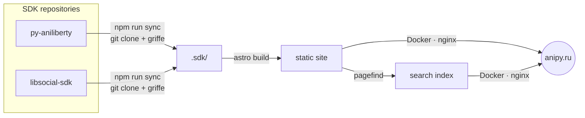

<div align="center">

<a href="https://anipy.ru/en/"></a>

<h1>anipy</h1>

<p><strong>The home of a collection of Python SDKs for anime, light novels and manga.</strong><br>
One site for docs, API reference, examples and releases of every library.</p>

<p>
  <a href="https://anipy.ru"></a>
  <a href="https://github.com/LLIJIYAPNIK/anipy/actions/workflows/ci.yml"></a>
  <a href="https://github.com/LLIJIYAPNIK/anipy/actions/workflows/deploy.yml"></a>
  <a href="LICENSE"></a>
  
</p>

<p><strong>English</strong> · <a href="README.ru.md">Русский</a></p>

</div>

---

## Contents

- [The collection](#the-collection)
- [What's on the site](#whats-on-the-site)
- [How it works](#how-it-works)
- [Getting started](#getting-started)
- [Project structure](#project-structure)
- [Design](#design)
- [Deployment](#deployment)
- [Contributing](#contributing)
- [License](#license)

## The collection

|  |  | Package | Platform | PyPI | Docs |
|:-:|:-:|---|---|---|---|
| **I** | アニメ | [`py-aniliberty`](https://github.com/LLIJIYAPNIK/py-aniliberty) | AniLibria / AniLiberty | [](https://pypi.org/project/py-aniliberty/) | [anipy.ru/en/docs/py-aniliberty](https://anipy.ru/en/docs/py-aniliberty/) |
| **II** | ラノベ | [`ranobelib-python-sdk`](https://github.com/LLIJIYAPNIK/libsocial-sdk/tree/main/packages/ranobelib) | RanobeLib | [](https://pypi.org/project/ranobelib-python-sdk/) | [anipy.ru/en/docs/ranobelib-python-sdk](https://anipy.ru/en/docs/ranobelib-python-sdk/) |
| **III** | 漫画 | [`mangalib-python-sdk`](https://github.com/LLIJIYAPNIK/libsocial-sdk/tree/main/packages/mangalib) | MangaLib | [](https://pypi.org/project/mangalib-python-sdk/) | [anipy.ru/en/docs/mangalib-python-sdk](https://anipy.ru/en/docs/mangalib-python-sdk/) |
|  |  | [`libsocial-core`](https://github.com/LLIJIYAPNIK/libsocial-sdk/tree/main/packages/core) | shared core of II and III | [](https://pypi.org/project/libsocial-core/) | [anipy.ru/en/docs/libsocial-core](https://anipy.ru/en/docs/libsocial-core/core/) |

All libraries are async, typed and MIT-licensed, for Python 3.11+.

```bash
pip install py-aniliberty         # anime — AniLibria
pip install ranobelib-python-sdk  # light novels — ranobelib.me
pip install mangalib-python-sdk   # manga — mangalib.me
```

## What's on the site

**[anipy.ru](https://anipy.ru)** is a showcase: it does not implement anything itself. Every word, signature and example comes from the SDK repositories at build time, so the site can't drift from the code.

- **Collection** — one panel per SDK. Open one and it takes the whole screen with a live background: a video for anime, an endless wall of covers for manga, a reading line of quotes for light novels.
- **Documentation** — every page of each SDK's `mkdocs.yml` nav: quick start, guides, API notes, upgrade notes. The shared core has its own section, linked from both site packages.
- **API reference** — built from the source code with [griffe](https://mkdocstrings.github.io/griffe/), the same engine mkdocstrings uses. You get signatures with linked types, parameter tables, inherited members and links to the source on GitHub.
- **API coverage** — every endpoint of the AniLibria API, with what the SDK calls for it and request/response examples.
- **Examples** — every runnable script from the SDKs' `examples/`, with a copy-to-run command.
- **Changelog** — releases of every SDK, plus an [Atom feed](https://anipy.ru/changelog.xml).
- **Search** — across all docs in both languages, `Ctrl` + `K`.
- **Two languages** — Russian and English interface. The docs text stays the English original.

## How it works



1. **`npm run sync`** clones the SDK repositories into `.sdk/` and extracts the API reference from their source with griffe (via `uv`).
2. **`astro build`** turns READMEs, `mkdocs.yml` pages, OpenAPI specs, examples and changelogs into static pages. Current versions come from PyPI.
3. **Pagefind** indexes the docs for search, then the site ships as an nginx Docker image.

## Getting started

**Requirements:** Node.js ≥ 22.18, [uv](https://docs.astral.sh/uv/) (for the API reference), git.

```bash
git clone https://github.com/LLIJIYAPNIK/anipy.git
cd anipy
npm install
npm run sync      # clone the SDK repositories into .sdk/ and build the API reference
npm run dev       # dev server at http://localhost:4321
```

| Command | What it does |
|---|---|
| `npm run sync` | clones or updates the SDK repositories, extracts the API reference |
| `npm run dev` | dev server with hot reload |
| `npm run check` | type and content schema checks (`astro check`) |
| `npm run build` | static build into `dist/` plus the search index |
| `npm run preview` | serves `dist/` — the only place where search works |

## Project structure

```text
src/
  data/sdks.ts        # the collection: one record per SDK, nothing else to add
  lib/                # SDK content → site data: docs, API reference, coverage, examples, versions
  components/         # panels, docs layout, search, coverage table (the only Preact island)
  pages/[lang]/       # /ru/… and /en/…: home, docs, examples, changelog, coverage, about
  i18n/               # interface strings, Russian and English
  styles/             # design tokens and motion
scripts/              # sync, API reference extraction, media and link-preview preparation
deploy/               # nginx and docker compose for the server
docs/deploy.md        # server setup and secrets
```

## Design

- **Black and white only.** Character comes from motion, type and Japanese titles, not colour. Code highlighting is grayscale too.
- **One large animation at a time.** Kana is "written" top to bottom, the ensō draws itself, panels open smoothly.
- **`prefers-reduced-motion` is respected everywhere.** Every duration is a design token, and all of them turn to zero.
- **Fluid scale** from a 1440 px layout up to 2560 px; the homepage always fits one screen.

## Deployment

Every push to `main` builds an image, publishes it to `ghcr.io/llijiyapnik/anipy` and restarts the container on the server; TLS is handled by nginx on the host. After an SDK release the site is rebuilt by hand: **Actions → Deploy → Run workflow**. Server setup and secrets: [`docs/deploy.md`](docs/deploy.md).

## Contributing

- Plans and progress live in issues: the [roadmap](https://github.com/LLIJIYAPNIK/anipy/issues/1) and [milestones](https://github.com/LLIJIYAPNIK/anipy/milestones).
- Something wrong in the docs text, an example or a signature? It comes from an SDK repository — please open the issue there.
- Changes to the site: one feature per branch and pull request, [Conventional Commits](https://www.conventionalcommits.org/), and `npm run check` and `npm run build` must pass.

## License

[MIT](LICENSE) © Kulebyakin Alexander
