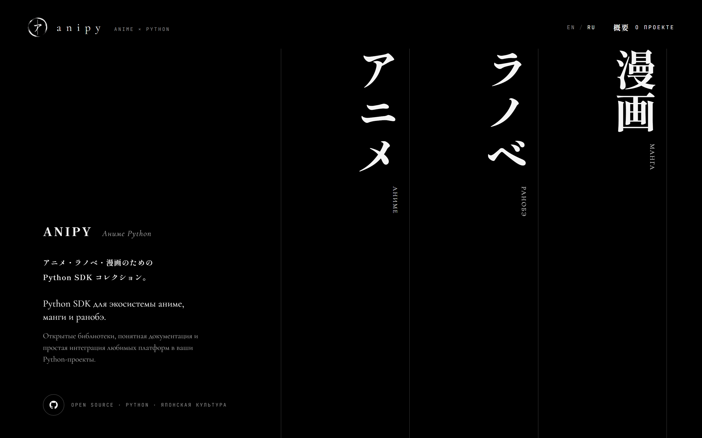
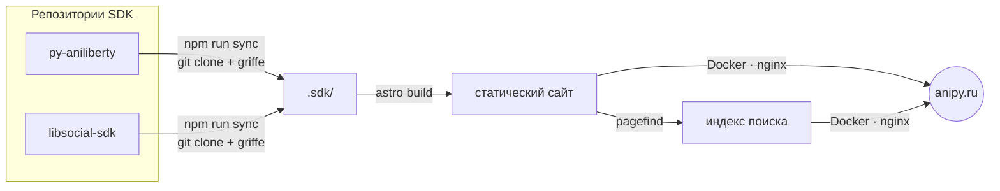

<div align="center">

<a href="https://anipy.ru/ru/"></a>

<h1>anipy</h1>

<p><strong>Дом коллекции Python SDK для аниме, ранобэ и манги.</strong><br>
Один сайт для документации, справочника API, примеров и релизов каждой библиотеки.</p>

<p>
  <a href="https://anipy.ru"></a>
  <a href="https://github.com/LLIJIYAPNIK/anipy/actions/workflows/ci.yml"></a>
  <a href="https://github.com/LLIJIYAPNIK/anipy/actions/workflows/deploy.yml"></a>
  <a href="LICENSE"></a>
  
</p>

<p><a href="README.md">English</a> · <strong>Русский</strong></p>

</div>

---

## Содержание

- [Коллекция](#коллекция)
- [Что есть на сайте](#что-есть-на-сайте)
- [Как это устроено](#как-это-устроено)
- [Запуск](#запуск)
- [Структура проекта](#структура-проекта)
- [Оформление](#оформление)
- [Выкладка](#выкладка)
- [Как помочь проекту](#как-помочь-проекту)
- [Лицензия](#лицензия)

## Коллекция

|  |  | Пакет | Платформа | PyPI | Документация |
|:-:|:-:|---|---|---|---|
| **I** | アニメ | [`py-aniliberty`](https://github.com/LLIJIYAPNIK/py-aniliberty) | AniLibria / AniLiberty | [](https://pypi.org/project/py-aniliberty/) | [anipy.ru/ru/docs/py-aniliberty](https://anipy.ru/ru/docs/py-aniliberty/) |
| **II** | ラノベ | [`ranobelib-python-sdk`](https://github.com/LLIJIYAPNIK/libsocial-sdk/tree/main/packages/ranobelib) | RanobeLib | [](https://pypi.org/project/ranobelib-python-sdk/) | [anipy.ru/ru/docs/ranobelib-python-sdk](https://anipy.ru/ru/docs/ranobelib-python-sdk/) |
| **III** | 漫画 | [`mangalib-python-sdk`](https://github.com/LLIJIYAPNIK/libsocial-sdk/tree/main/packages/mangalib) | MangaLib | [](https://pypi.org/project/mangalib-python-sdk/) | [anipy.ru/ru/docs/mangalib-python-sdk](https://anipy.ru/ru/docs/mangalib-python-sdk/) |
|  |  | [`libsocial-core`](https://github.com/LLIJIYAPNIK/libsocial-sdk/tree/main/packages/core) | общее ядро II и III | [](https://pypi.org/project/libsocial-core/) | [anipy.ru/ru/docs/libsocial-core](https://anipy.ru/ru/docs/libsocial-core/core/) |

Все библиотеки асинхронные, типизированные, под лицензией MIT, для Python 3.11+.

```bash
pip install py-aniliberty         # аниме — AniLibria
pip install ranobelib-python-sdk  # ранобэ — ranobelib.me
pip install mangalib-python-sdk   # манга — mangalib.me
```

## Что есть на сайте

**[anipy.ru](https://anipy.ru)** — витрина: сам сайт ничего не реализует. Каждое слово, сигнатура и пример берутся из репозиториев SDK при сборке, поэтому сайт не расходится с кодом.

- **Коллекция** — по панели на SDK. Раскрытая панель занимает весь экран и оживает: у аниме — видео, у манги — бесконечная стена обложек, у ранобэ — строка чтения из цитат.
- **Документация** — все страницы из `nav` в `mkdocs.yml` каждого SDK: быстрый старт, гайды, заметки об API, переход на новые версии. У общего ядра свой раздел, на него ссылаются оба SDK сайтов lib.social.
- **Справочник API** — собирается из исходного кода с помощью [griffe](https://mkdocstrings.github.io/griffe/), того же движка, что у mkdocstrings. Сигнатуры со ссылками на типы, таблицы параметров, унаследованные методы, ссылки на исходник на GitHub.
- **Покрытие API** — каждый эндпоинт API AniLibria: какой метод SDK его вызывает, примеры запроса и ответа.
- **Примеры** — все готовые к запуску скрипты из `examples/` SDK, с командой для копирования.
- **Изменения** — релизы всех SDK и [лента Atom](https://anipy.ru/changelog.xml).
- **Поиск** — по всей документации на обоих языках, `Ctrl` + `K`.
- **Два языка** — интерфейс на русском и английском. Текст документации — английский оригинал.

## Как это устроено



1. **`npm run sync`** клонирует репозитории SDK в `.sdk/` и извлекает справочник API из их исходников через griffe (с помощью `uv`).
2. **`astro build`** превращает README, страницы `mkdocs.yml`, спецификации OpenAPI, примеры и changelog в статические страницы. Актуальные версии берутся с PyPI.
3. **Pagefind** строит индекс поиска по документации, затем сайт уходит на сервер Docker-образом с nginx.

## Запуск

**Нужны:** Node.js ≥ 22.18, [uv](https://docs.astral.sh/uv/) (для справочника API), git.

```bash
git clone https://github.com/LLIJIYAPNIK/anipy.git
cd anipy
npm install
npm run sync      # клонирует репозитории SDK в .sdk/ и собирает справочник API
npm run dev       # dev-сервер на http://localhost:4321
```

| Команда | Что делает |
|---|---|
| `npm run sync` | клонирует или обновляет репозитории SDK, извлекает справочник API |
| `npm run dev` | dev-сервер с горячей перезагрузкой |
| `npm run check` | проверка типов и схем контента (`astro check`) |
| `npm run build` | статическая сборка в `dist/` и индекс поиска |
| `npm run preview` | раздаёт `dist/` — только там работает поиск |

## Структура проекта

```text
src/
  data/sdks.ts        # коллекция: по записи на SDK, больше ничего добавлять не нужно
  lib/                # контент SDK → данные сайта: документация, справочник API, покрытие, примеры, версии
  components/         # панели, каркас документации, поиск, таблица покрытия (единственный остров Preact)
  pages/[lang]/       # /ru/… и /en/…: главная, документация, примеры, изменения, покрытие, о проекте
  i18n/               # строки интерфейса на русском и английском
  styles/             # токены оформления и анимация
scripts/              # синхронизация, справочник API, подготовка медиа и превью ссылок
deploy/               # nginx и docker compose для сервера
docs/deploy.md        # настройка сервера и секреты
```

## Оформление

- **Только чёрное и белое.** Характер дают движение, шрифты и японские заголовки, а не цвет. Подсветка кода — тоже в оттенках серого.
- **Одна крупная анимация за раз.** Кана «пишется» сверху вниз, энсо дорисовывается по кругу, панели раскрываются плавно.
- **`prefers-reduced-motion` соблюдается везде.** Все длительности — токены оформления, и все они обнуляются.
- **Плавный масштаб** от макета 1440 px до 2560 px; главная всегда помещается в один экран.

## Выкладка

Каждый push в `main` собирает образ, публикует его в `ghcr.io/llijiyapnik/anipy` и перезапускает контейнер на сервере; TLS — у nginx на хосте. После релиза SDK сайт пересобирают вручную: **Actions → Deploy → Run workflow**. Настройка сервера и секреты: [`docs/deploy.md`](docs/deploy.md).

## Как помочь проекту

- Планы и ход работы — в issues: [roadmap](https://github.com/LLIJIYAPNIK/anipy/issues/1) и [milestones](https://github.com/LLIJIYAPNIK/anipy/milestones).
- Ошибка в тексте документации, примере или сигнатуре? Они приходят из репозитория SDK — заведите issue там.
- Изменения сайта: одна фича — одна ветка и pull request, [Conventional Commits](https://www.conventionalcommits.org/ru/), `npm run check` и `npm run build` должны проходить.

## Лицензия

[MIT](LICENSE) © Kulebyakin Alexander
